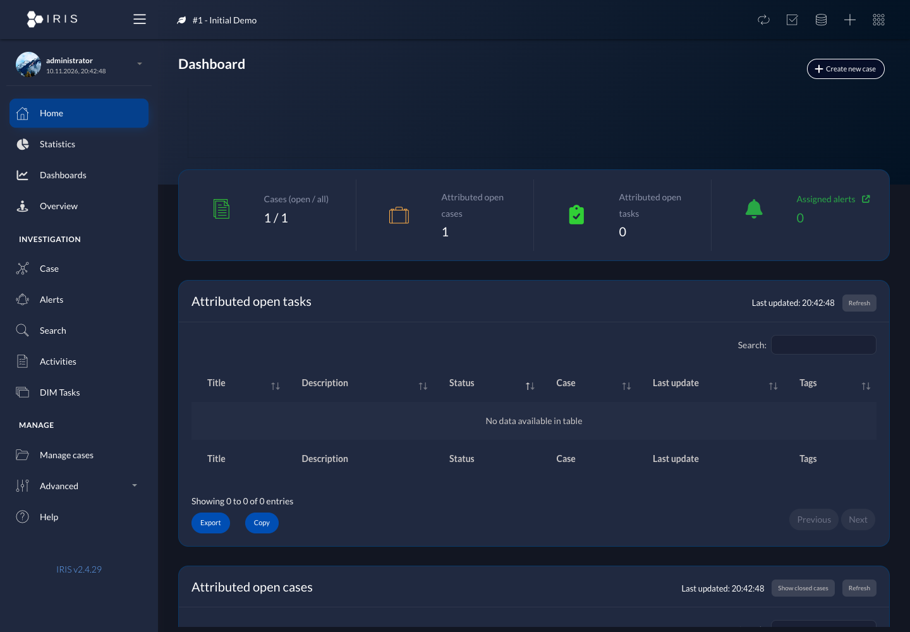
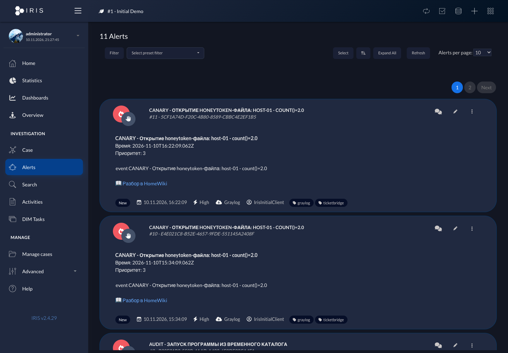
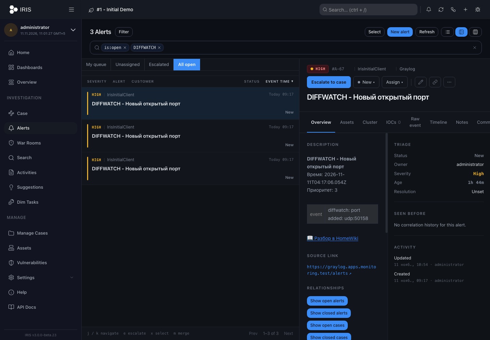
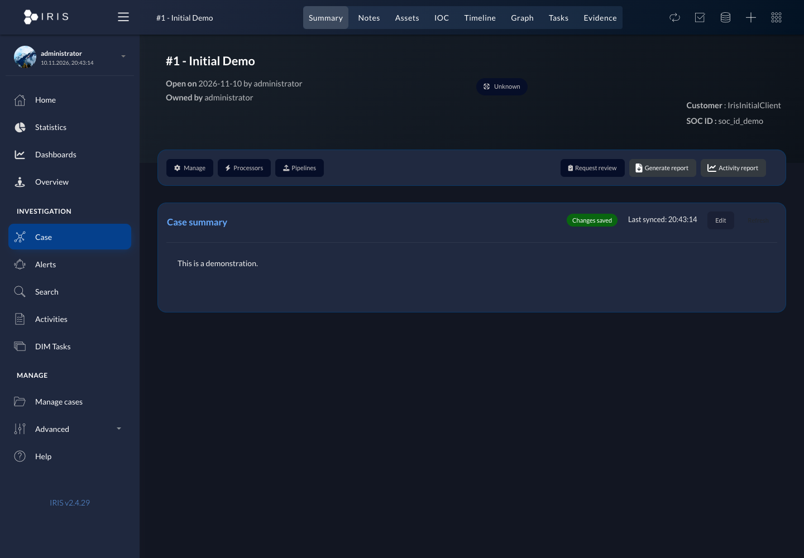

# DFIR-IRIS — развёртывание в домашней лаборатории

Платформа регистрации и расследования инцидентов ИБ [DFIR-IRIS](https://www.dfir-iris.org/)
(LGPL-3.0) на RED OS 8 + podman + Caddy. Алерты Graylog попадают в IRIS
автоматически через [TicketBridge](https://github.com/ArsIS-02/ticketbridge).

## Скриншоты



| Очередь алертов | Детали алерта |
|---|---|
|  |  |



## Текущий стек

С **11.11.2026** основной экземпляр работает на **v3.0.0-beta.23**:

- основной адрес: **https://iris.apps.monitoring.test**;
- `iris-next.apps.monitoring.test` перенаправляет на основной адрес;
- рабочий каталог на сервере: `~/dfir-iris-v3-test/`;
- compose на сервере: `docker-compose.yml`; эталон в репозитории:
  `docker-compose.v3.yml`;
- контейнеры: `iris3test_db` (PostgreSQL 18), `iris3test_app`,
  `iris3test_worker`, `iris3test_frontend`, `iris3test_rabbitmq`,
  `iris3test_nginx`;
- порт **8102** (HTTPS, self-signed), снаружи Caddy;
- автозапуск: `systemctl --user dfir-iris` (enabled).

Префикс `iris3test` и имя каталога оставлены после тестовой миграции: это основной
экземпляр, а не отдельный стенд. Старый v2.4.29 остановлен, но его каталог
`~/dfir-iris/` и named volumes сохранены для отката.

## Управление

```bash
cd ~/dfir-iris-v3-test
podman-compose ps
podman-compose logs --tail 100 app
systemctl --user status dfir-iris

# Перезапуск всего текущего стека
systemctl --user restart dfir-iris

# Только приложение
podman restart iris3test_app

# Остановка без удаления томов
systemctl --user stop dfir-iris
```

При обновлении beta-версии сначала сделать бэкап и проверить миграцию на копии.
Затем изменить теги образов в `docker-compose.yml` и выполнить:

```bash
cd ~/dfir-iris-v3-test
podman-compose pull
podman-compose up -d
```

## Caddy

```
iris.apps.monitoring.test {
    tls internal
    reverse_proxy https://host.containers.internal:8102 {
        transport http {
            tls
            tls_insecure_skip_verify
        }
    }
}

iris-next.apps.monitoring.test {
    tls internal
    redir https://iris.apps.monitoring.test{uri} permanent
}
```

После изменения `~/n8n-docker-caddy/Caddyfile`:

```bash
podman exec caddy caddy validate --config /etc/caddy/Caddyfile --adapter caddyfile
podman exec caddy caddy reload --config /etc/caddy/Caddyfile --adapter caddyfile
```

## systemd (`~/.config/systemd/user/dfir-iris.service`)

```
[Unit]
Description=DFIR-IRIS — управление инцидентами ИБ
After=network-online.target

[Service]
Type=oneshot
RemainAfterExit=yes
WorkingDirectory=%h/dfir-iris-v3-test
ExecStart=/usr/bin/podman-compose up -d
ExecStop=/usr/bin/podman-compose down

[Install]
WantedBy=default.target
```

## Вход и API

- Логин администратора: `administrator`; пароль тот же, что был до миграции.
- Смена пароля: профиль → Change password.
- API-ключ: профиль → API Key. После Renew старый ключ перестаёт работать.
- Приём алертов v3: `POST /api/v2/alerts`, заголовок
  `Authorization: Bearer <key>`.
- TicketBridge на сервере настроен с `TB_IRIS_API_PATH=/api/v2/alerts` и
  использует основной `TB_IRIS_URL=https://iris.apps.monitoring.test`.
- Severity: Graylog priority 3→High(5), 2→Medium(1), 1→Low(4).

## Почтовые уведомления

Исходящий SMTP в IRIS v3 настраивается через **Settings → Server settings →
OUTBOUND MAIL (SMTP)** и хранится в базе, а не в `.env`. С 11.11.2026 включена
отправка через `smtp.mail.ru:465` с Implicit SSL и аутентификацией. Используется
тот же ящик и пароль приложения, что в Graylog; адрес отправителя —
`arsentyev_is@mail.ru`, отображаемое имя — **IRIS Homelab**. Секрет не записывается
в Git или `.env`. Штатный **Send test** и реальное фирменное уведомление успешно
переданы SMTP; визуальное отображение во входящих проверяется отдельно.

Для лаборатории предусмотрено разделение без дублей: Graylog отправляет письма о
новых алертах, а IRIS — о назначении/эскалации алертов, задачах, изменениях кейсов,
упоминаниях и War Rooms. События `alert_created` в IRIS v3.0.0-beta.23 нет.
Администратору (`user_id=1`) задан тот же email, включён канал `email` для событий
`mention`, `task_assigned`, `case_state_change`, `case_assigned`, `alert_assigned`,
`alert_escalated`, `war_room_message`, `war_room_thread_reply`. Для `ai_suggestion`
и `module_custom` почта оставлена выключенной, чтобы не создавать лишний шум.
Пользовательские каналы настраиваются в **My profile → Notifications**, значения по
умолчанию — в **Settings → Platform → Notifications**.

### Фирменный HTML-шаблон IRIS Homelab

Персистентная кастомизация находится в `custom/mail/outbound.py` и
`custom/templates/email/notification.html`, подключается к **app и worker** через
read-only mount с SELinux-меткой `:ro,z` в `docker-compose.v3.yml`. Публичный адрес
для кнопок задаётся отдельно: `IRIS_PUBLIC_URL=https://iris.apps.monitoring.test`
(не следует использовать CORS-параметр `IRIS_ALLOW_ORIGIN`).

HTML выполнен в тёмном стиле Graylog, с цветовой индикацией критичности и русскими
названиями событий. Для алертов письмо дополняется из `source_type=alert` и
`source_id`. **Хост** извлекается из `group_by_fields`, полей события или источника
Graylog и выводится первым основным полем. Также показываются критичность, статус,
источник, ответственный, клиент, теги и технические поля. **Время уведомления** —
актуальный момент формирования письма; **время исходного события** показывается
отдельно. Все даты выводятся в зоне Екатеринбурга с явным `UTC+05:00`.

HTML-описание TicketBridge безопасно преобразуется в структурированный plain text:
теги `<b>`, `<br>`, `<table>` не попадают в письмо, строки события сохраняются.
Повторяющиеся заголовок, старая метка времени, числовой приоритет и ссылка HomeWiki
удаляются из описания, поскольку уже представлены основными полями и кнопкой.
Предусмотрены **«Открыть в IRIS»**, **«Источник в Graylog»** (Replay Search) и
**«Разбор в HomeWiki»**. Если исходный объект удалён или данных недостаточно,
отправляется универсальное уведомление без падения задачи. Plain text сохраняется
как основной MIME-вариант, HTML — alternative.

Динамические значения экранируются Jinja; разрешены только HTTP(S) и безопасные
относительные ссылки. Поля с паролями, токенами, ключами и учётными данными рекурсивно
исключаются из технического блока, длинные значения ограничиваются. После изменения
шаблона нужно перезапустить `iris3test_app` и `iris3test_worker`.

В `docker-compose.v3.yml` также задан `IRIS_ADM_EMAIL=arsentyev_is@mail.ru`. Это
обязательно: штатный `post_init` при каждом запуске применяет конфигурационный email
администратора, а без параметра возвращает `administrator@localhost`. После задания
переменной сохранение рабочего адреса проверено полным пересозданием app.

Проверки: `python -m unittest discover -s tests -v` — 4 теста, включая реальный
HTML-формат описания, приоритет хоста и актуальное время уведомления. 11.11.2026 в
13:16 (UTC+5) исправленное уведомление на данных алерта № 14 прошло Celery и было
передано SMTP (`emailed_at` заполнен, задача `True`). Тестовая запись Notification
удалена; алерт не изменялся. Резервные копии: `backups/20261111-122536/` и
`backups/before-mail-layout-20261111-1255/` в `~/dfir-iris-v3-test/`.

Кнопка **Send test** сохраняет SMTP-конфигурацию и синхронно отправляет простое
системное письмо, а не HTML-шаблон уведомления. Локальный Postfix на `redos-server`
слушает только `127.0.0.1:25` и `[::1]:25`; по `host.containers.internal:25` из
контейнера он недоступен и для текущей схемы не используется.

**INBOUND MAIL (IMAP)** и **Mail ingest / Mail rules** относятся к созданию объектов
из входящих писем и для исходящих уведомлений не требуются. Пароль SMTP зашифрован
ключом, производным от `SECRET_KEY`; после смены `SECRET_KEY` его нужно ввести заново.
Отправкой занимается worker: до 5 попыток с экспоненциальной задержкой (потолок
600 секунд), поэтому контейнер `iris3test_worker` должен быть запущен.

## Миграция v2 → v3 (11.11.2026)

Перед переключением была остановлена запись и снят финальный дамп PostgreSQL 12.
В v3 перенесены **69 алертов и 1 кейс**, а также содержимое томов
`iris-downloads`, `user_templates` и `server_data`. После миграции проверены:

- итоговая ревизия Alembic `a6d3f8b2c917`;
- вход существующего пользователя и отображение 56 открытых алертов;
- создание алерта через TicketBridge и `POST /api/v2/alerts` (HTTP 201),
  затем удаление тестового алерта (HTTP 204);
- HTTP 200 по старому основному адресу и перенаправление с `iris-next`.

Резервный набор переключения:

```
~/dfir-iris-v3-test/backups/cutover-20261111-101140/
```

В нём сохранены финальный дамп `iris_pg12_final.sql.gz`, прежние Caddyfile,
systemd units, конфигурации IRIS и TicketBridge. Особенность миграции: ревизия
v2.4.29 `e5d79b8c4a55` отсутствует в графе v3.0.0-beta.23. На копии счётчик был
возвращён к общему предку `d5a720d1b99b`, после чего штатные миграции v3
применились, включая `c7f1e2a4d810` для существующих таблиц дашбордов.

## Откат на v2.4.29

Использовать только при необходимости: данные, созданные в v3 после
переключения, в старой базе не появятся автоматически.

1. Остановить TicketBridge и текущий IRIS:
   `systemctl --user stop ticketbridge dfir-iris`.
2. Восстановить `Caddyfile`, `dfir-iris.service` и `ticketbridge.env` из
   резервного каталога переключения.
3. Вернуть `TB_IRIS_API_PATH=/alerts/add` (или убрать параметр).
4. Выполнить `systemctl --user daemon-reload`, запустить `dfir-iris` со старым
   unit (каталог `~/dfir-iris`), перезагрузить Caddy и запустить TicketBridge.
5. Проверить вход и API v2. Старые named volumes не удалялись.

## Грабли, которые уже встречались

1. `IRIS_WORKER=1` в `.env` → приложение не стартует CSRF («A secret key is required»).
   Переменная должна быть только у worker, в `.env` её не пишем.
2. SELinux: без `chcon -R -t container_file_t certificates/` nginx не читает сертификаты.
3. Ключ `iris_key.pem` должен быть читаемым (644) — nginx работает не от root.
4. `:ro:z` в mounts podman-compose не парсит — используем `:ro` + `chcon`.
5. Короткие имена образов (`rabbitmq:...`) требуют полного пути `docker.io/library/...`.

## Бэкап текущей базы

```bash
mkdir -p ~/dfir-iris-v3-test/backups
podman exec iris3test_db pg_dump -U postgres iris_db | \
  gzip > ~/dfir-iris-v3-test/backups/iris_v3_$(date +%F_%H%M).sql.gz
```

`docker-compose.yml` в репозитории сохраняет прежнюю конфигурацию v2.4.29 только
для отката. Инструкция для пользователей — `HOMEWIKI_ARTICLE.md` (опубликована в
HomeWiki, статья `art-iris`).
