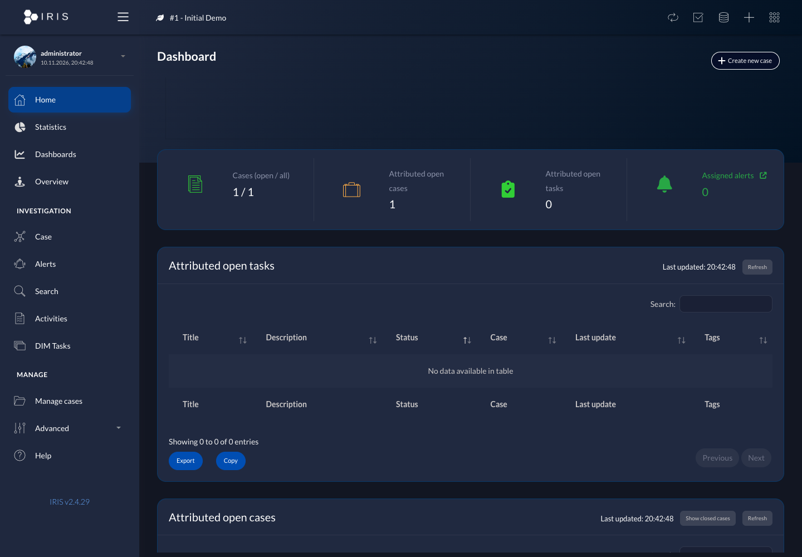
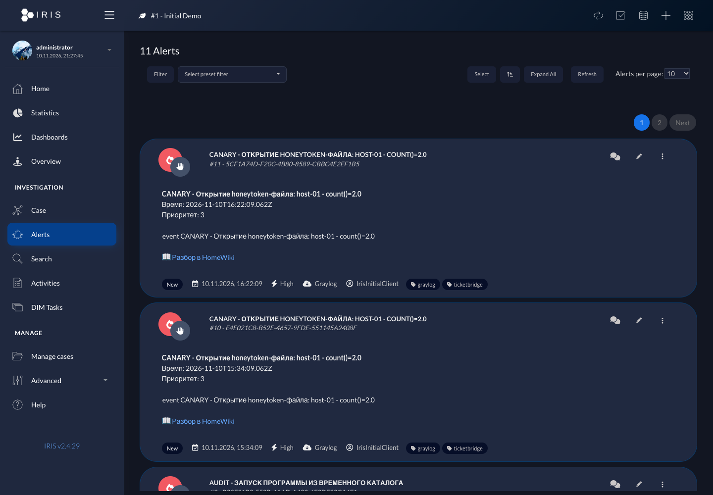
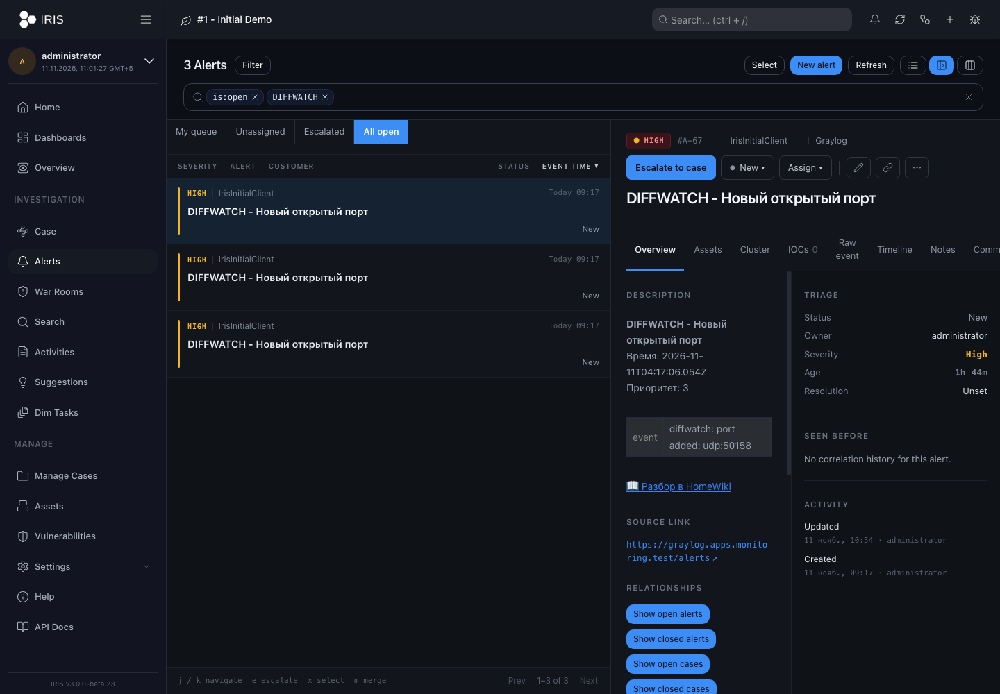
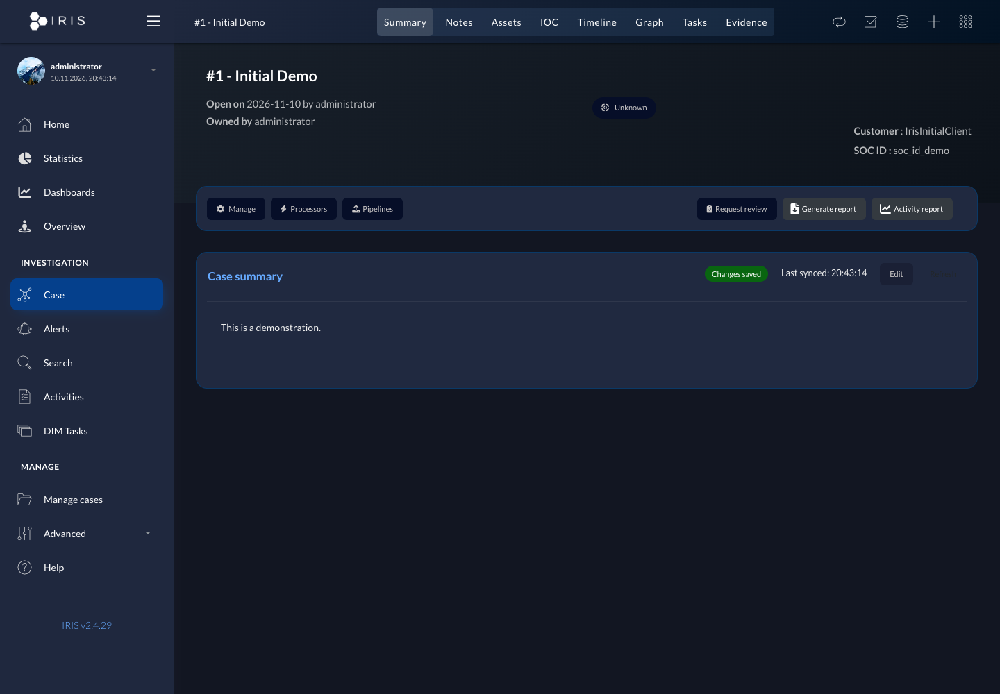

# DFIR-IRIS — развёртывание в домашней лаборатории

Платформа регистрации и расследования инцидентов ИБ [DFIR-IRIS](https://www.dfir-iris.org/)
(LGPL-3.0) на RED OS 8 + podman + Caddy. Алерты Graylog попадают в IRIS
автоматически через [TicketBridge](https://github.com/ArsIS-02/ticketbridge).

## Скриншоты



| Очередь алертов | Детали алерта |
|---|---|
|  |  |



## Текущий стек

С **11.11.2026** основной экземпляр работает на **v3.0.0-beta.23**:

- основной адрес: **https://iris.apps.monitoring.test**;
- `iris-next.apps.monitoring.test` перенаправляет на основной адрес;
- рабочий каталог на сервере: `~/dfir-iris-v3-test/`;
- compose на сервере: `docker-compose.yml`; эталон в репозитории:
  `docker-compose.v3.yml`;
- контейнеры: `iris3test_db` (PostgreSQL 18), `iris3test_app`,
  `iris3test_worker`, `iris3test_frontend`, `iris3test_rabbitmq`,
  `iris3test_nginx`;
- порт **8102** (HTTPS, self-signed), снаружи Caddy;
- автозапуск: `systemctl --user dfir-iris` (enabled).

Префикс `iris3test` и имя каталога оставлены после тестовой миграции: это основной
экземпляр, а не отдельный стенд. Старый v2.4.29 остановлен, но его каталог
`~/dfir-iris/` и named volumes сохранены для отката.

## Управление

```bash
cd ~/dfir-iris-v3-test
podman-compose ps
podman-compose logs --tail 100 app
systemctl --user status dfir-iris

# Перезапуск всего текущего стека
systemctl --user restart dfir-iris

# Только приложение
podman restart iris3test_app

# Остановка без удаления томов
systemctl --user stop dfir-iris
```

При обновлении beta-версии сначала сделать бэкап и проверить миграцию на копии.
Затем изменить теги образов в `docker-compose.yml` и выполнить:

```bash
cd ~/dfir-iris-v3-test
podman-compose pull
podman-compose up -d
```

## Caddy

```
iris.apps.monitoring.test {
    tls internal
    reverse_proxy https://host.containers.internal:8102 {
        transport http {
            tls
            tls_insecure_skip_verify
        }
    }
}

iris-next.apps.monitoring.test {
    tls internal
    redir https://iris.apps.monitoring.test{uri} permanent
}
```

После изменения `~/n8n-docker-caddy/Caddyfile`:

```bash
podman exec caddy caddy validate --config /etc/caddy/Caddyfile --adapter caddyfile
podman exec caddy caddy reload --config /etc/caddy/Caddyfile --adapter caddyfile
```

Адрес `iris.apps.monitoring.test` должен быть объявлен **только один раз**. До
исправления 11.11.2026 старый upstream `8101` оставался также в
`caddy_config/Caddyfile.apps`, из-за чего `caddy reload` возвращал `ambiguous
site definition`. Устаревший блок удалён, актуальный upstream `8102` сохранён;
validate и reload прошли успешно. Резервные файлы имеют суффикс
`.bak-iris-dedup-20261111T133007Z`.

Для плитки Atrium в `~/homelab-services/services.yaml` заданы
`backend: host.containers.internal:8102`, `scheme: https` и `insecure: true`.
Последнее нужно прямому health-check из контейнера Atrium: без него проверка
самоподписанного сертификата возвращала `code=0 / bad`, а с ним — `200 / ok`.
Копия конфигурации: `services.yaml.bak-iris-8102-20261111T133237Z`.

## systemd (`~/.config/systemd/user/dfir-iris.service`)

```
[Unit]
Description=DFIR-IRIS — управление инцидентами ИБ
After=network-online.target

[Service]
Type=oneshot
RemainAfterExit=yes
WorkingDirectory=%h/dfir-iris-v3-test
ExecStart=/usr/bin/podman-compose up -d
ExecStop=/usr/bin/podman-compose down

[Install]
WantedBy=default.target
```

## Вход и API

- Логин администратора: `administrator`; пароль тот же, что был до миграции.
- Смена пароля: профиль → Change password.
- API-ключ: профиль → API Key. После Renew старый ключ перестаёт работать.
- Приём алертов v3: `POST /api/v2/alerts`, заголовок
  `Authorization: Bearer <key>`.
- TicketBridge на сервере настроен с `TB_IRIS_API_PATH=/api/v2/alerts` и
  использует основной `TB_IRIS_URL=https://iris.apps.monitoring.test`.
- Все активные правила Graylog привязаны к TicketBridge (255/255 на 11.11.2026):
  High создаёт алерт IRIS и заявку GLPI, Medium/Low — только алерт IRIS.
- Severity: Graylog priority 3→High(5), 2→Medium(1), 1→Low(4). Вручную приоритет
  меняется в карточке **алерт → Edit → Severity → Save**.

## Фоновое обновление очереди алертов

Frontend собирается из точной upstream-ревизии `3e02ba0d221235968b188c440faaeac4169f0714`
(**v3.0.0-beta.23**) с патчем `custom/frontend/alerts-auto-refresh.patch`. Очередь
обновляется каждые **30 секунд без перезагрузки страницы** через штатный загрузчик:
текущие фильтры, страница, режим List/Split/Board и прокрутка сохраняются. Обновление
не запускается, когда вкладка скрыта, идёт другой запрос, открыт диалог/панель фильтров
или фокус находится в поле ввода. При возвращении на вкладку выполняется проверка сразу.

Образ: `localhost/iris-frontend-homelab:v3.0.0-beta.23-auto-refresh`.
Пересборка на сервере:

```bash
cd ~/dfir-iris-v3-test
bash custom/frontend/build.sh
podman-compose up -d frontend
```

Проверки upstream с патчем: **3172 теста в 238 файлах**, `npm run check` — 0 ошибок
(8 исходных предупреждений в других компонентах), production `npm run build` успешна.
При обновлении IRIS нужно сменить закреплённую ревизию в `custom/frontend/build.sh`,
проверить применимость патча и повторить тесты, а не переносить его вслепую.

## Точное время открытия кейсов

В списке кейсов колонка **Opened** показывает существующее поле `initial_date` с точным временем,
а не `open_date` типа `Date`, которое при форматировании выглядело как полночь. Backend отдаёт
`initial_date` через `CaseSchemaForAPIV2` только для чтения; изменить его через API нельзя. Миграция
БД не требуется: поле уже существует и заполняется при создании кейса. Для ответа старого backend
frontend использует прежний `open_date` как fallback. Сортировка колонки выполняется по `initial_date`.

Изменения закреплены в `custom/schema/marshables.py` и `custom/frontend/case-opened-at.patch`;
schema монтируется только в контейнер `app`. Регрессионная проверка
`custom/tests/test_case_initial_date_schema.py` подтверждает сериализацию точного timestamp и
`dump_only`. Полный frontend-набор: **3180 тестов в 239 файлах**, `npm run check` — 0 ошибок
(8 исходных предупреждений), production-сборка успешна. Обновление на сервере:
`bash custom/frontend/build.sh && podman-compose up -d --force-recreate app frontend`.

## Точное время закрытия кейсов

В списке кейсов колонка **Close date** показывает вычисляемое read-only поле `closed_at`, а не
`close_date` типа `Date`, которое при форматировании выглядело как полночь. Backend находит согласованное
с `close_date` событие `case closed` в `Cases.modification_history`. Если его нет, используется последняя
запись `Case closed` или `Closed case ID …` за ту же дату в `user_activity`. Для открытого кейса поле равно
`null`; при ответе старого backend или отсутствии точной аудиторской записи frontend использует прежний
`close_date` как fallback. Изменить `closed_at` через API нельзя.

Миграция БД не требуется. Изменения закреплены в `custom/schema/marshables.py` и
`custom/frontend/case-closed-at.patch`; schema монтируется только в контейнер `app`. Проверки
`custom/tests/test_case_closed_at_schema.py` и `custom/tests/test_case_closed_at_patch.py` подтверждают
выбор согласованного закрытия, резервный журнал, очистку после повторного открытия, `dump_only` и fallback.

## Отображение Cases как Incidents

Патч `custom/frontend/incident-terminology.patch` меняет только видимые подписи интерфейса:
`Case/Cases/case/cases` и русские формы слова «кейс» отображаются как «Incident/Incidents/
инцидент» с учётом регистра и падежа. Общий Svelte-action подключён к `<svelte:body>`, поэтому
обрабатывает также динамические диалоги и порталы. Заголовок документа обновляется тоже.

API, маршруты `/case/...`, `/manage/cases`, `case_id`, имена сервисов и значения в БД не меняются.
Не обрабатываются значения полей ввода, редакторы, код и технические выражения вроде
`case-sensitive`, `use case` и `CaseService`. В `placeholder`, `title` и `aria-label` меняется только
безопасная отображаемая терминология. Почтовый модуль `custom/mail/outbound.py` отдельно
нормализует `event_label`, `title` и `description`, включая `a case → an incident`; ссылки писем
и технические `source_type='case'` сохраняются.

Регрессии: **3186 frontend-тестов в 240 файлах**, 6 тестов `tests/test_notification_mail.py`,
`npm run check` — 0 ошибок (8 исходных предупреждений), production-сборка успешна. Проверка
состава патча — `custom/tests/test_incident_terminology_patch.py`. Миграция БД не требуется.

## Velociraptor: сбор из модального окна кейса

Патч `custom/frontend/case-velociraptor.patch` добавляет **Case menu → Workflow →
Collect with Velociraptor**. Команда открывает диалог внутри IRIS, а не отдельную вкладку.
Оператор выбирает актив кейса, видит Client ID из `custom_attributes.velociraptor.client_id`,
может исправить его и отдельной кнопкой **Save to asset** сохранить через штатный API IRIS.
Сохранение не запускает сбор. Для запуска нужно явное подтверждение; `asset_id`, выбранная ОС
и фактические имена артефактов включаются в метаданные Evidence ZIP. ОС предлагается по типу
актива, но её можно переопределить. Каталог загружается из серверного allowlist TicketBridge:
49 артефактов для Linux/РЕД ОС, 12 для macOS и 28 для Windows. Доступны поиск, рекомендуемый
набор, очистка и множественный выбор до 8 артефактов. При смене актива, ОС или состава сбора
подтверждение требуется заново. Произвольные имена, VQL, параметры и remediation недоступны;
сервер дополнительно сверяет выбранную ОС с ОС клиента Velociraptor.

Каждый артефакт выполняется отдельным последовательным Flow. Все результаты и ошибки сохраняются
в одном Evidence ZIP; частичный сбой не отменяет успешные сборы. Для артефактов с временным окном
используются последние 30 дней. Для двух DNF-правил в описании указано обращение к репозиториям;
`SuspiciousXattrs` явно ограничен первым уровнем каталогов.

Подтверждённый запуск выполняется с `async=1`: backend возвращает HTTP 202 и `job_id`, а диалог
отслеживает фоновую задачу через `GET /velociraptor/jobs/{job_id}`. После закрытия и повторного
открытия диалог восстанавливает последний результат по `case_id` или `alert_id` без нового POST
и без повторного Flow. Ручная смена актива, ОС или артефактов по-прежнему сбрасывает результат,
но позднее завершение автоматического resolver Client ID восстановленный результат не удаляет.
Для запуска из алерта после завершения добавляется комментарий со статусом, Job ID, Evidence ID,
SHA-256 и ссылками на Flow. Live-проверки 25.11.2026: сбор из инцидента №90 создал Evidence №113,
сбор из алерта №1431 — Evidence №114; восстановление обоих результатов подтверждено. Контролируемый
сбой доставки `evidence_error` на production специально не создавался; сценарий проверен автотестами.

На вкладке **Summary** инцидента компонент `VelociraptorJobsCard.svelte` показывает до трёх последних
задач обоих типов через `GET /velociraptor/jobs?incident_id=...`: Job ID, статус, Flow и прямую ссылку
на Evidence. **Refresh** только перечитывает историю и не создаёт новый Flow; автоматический опрос идёт
только для активных задач. При пустой истории карточка не отображается. В `build.sh` подстановка
`TB_KEY` и `TB_TICKETBRIDGE_URL` выполняется и для диалога, и для этой карточки.

Для `evidence_error` с сохранённым recovery-архивом карточка дополнительно показывает **Retry Evidence
upload**. После подтверждения вызывается `POST /velociraptor/jobs/{job_id}/retry-evidence`: TicketBridge
проверяет размер и SHA-256 сохранённого ZIP и повторяет только прикрепление Evidence, не создавая новый
Flow. При повторной ошибке recovery ZIP и исходные Flow сохраняются; после успеха Evidence ID и исходный
итог сбора восстанавливаются, а recovery-архив удаляется. Для старых задач без архива API возвращает
HTTP 409 вместо неявного нового сбора.

**Обязательное условие:** в **Settings → Custom Attributes → Assets** должна быть объявлена
вкладка `velociraptor` с полем `client_id` типа `input_string` (`value: ""`, `mandatory: false`).
Иначе IRIS возвращает HTTP 200 на обновление актива, но отбрасывает неизвестное поле. Схему нужно
сохранять обычным additive-режимом **Save**, не Partial/Complete overwrite. После настройки следует
повторно прочитать актив и убедиться, что Client ID сохранился и автозаполняется в диалоге.

Сборка требует `TB_KEY` и `TB_TICKETBRIDGE_URL`; секрет и адрес подставляются
только в локальный build context и не хранятся в патче. Рекомендуемый вариант —
`TB_TICKETBRIDGE_URL='/'`: браузер обращается к `/velociraptor/...` на том же origin, что и IRIS,
а внешний reverse-proxy направляет этот путь в TicketBridge. Это устраняет отдельные CORS- и CSP-проверки.
Для прямого междоменного подключения вместо `/` указывается полный origin TicketBridge. Например:
`TB_KEY='<secret>' TB_TICKETBRIDGE_URL='/' bash custom/frontend/build.sh`.
Полный набор: **3199 тестов в 241 файле**; `npm run check` — 0 ошибок (10 исходных предупреждений),
production `npm run build` успешна. Backend TicketBridge: **242 теста**.
Все пять frontend-патчей проверены командой `git apply --check` относительно закреплённого upstream. Браузер
получает имена только из серверного каталога; состав allowlist и builders дополнительно проверен
offline- и HTTP-тестами, включая отклонение кросс-платформенного выбора.

При same-origin схеме отдельный origin TicketBridge в `connect-src` не нужен. Если выбрано прямое
междоменное подключение, origin TicketBridge должен быть явно добавлен в `connect-src` политики
CSP nginx. Пример находится в `custom/nginx.conf`: перед сборкой замените
`https://ticketbridge.example.test` на свой origin, а `iris.example.test` — на свой `server_name`.
`custom/Containerfile.nginx` собирает образ с этой конфигурацией. Нельзя использовать `*` вместо
конкретного origin. После изменения нужно проверить ответный заголовок и preflight `OPTIONS`.
Иначе браузер покажет `Failed to fetch` ещё до отправки POST, не создав Flow.
Интеграционная проверка подтвердила загрузку Evidence ZIP,
корректные `case_id` и `asset_id`, состояние Flow `FINISHED` и контрольные суммы manifest.

## Whitelist и blacklist

В исходниках установленной **v3.0.0-beta.23** нет общего IOC-whitelist/blacklist,
который автоматически подавлял бы новые алерты или применял сетевые блокировки.
IOC имеют тип, описание, теги, TLP и обогащение, но эти атрибуты не являются списками
разрешений или запретов. Статусы **False Positive** и **Legitimate** фиксируют результат
разбора текущего алерта и не создают исключение для следующих событий.

В лаборатории разделение такое: исключения детектов настраиваются в **Graylog** (в самом
правиле или pipeline, максимально узко по хосту/процессу/пути), а блокировки IP и доменов —
в **BlockBoard/Keenetic**. Найденные в IRIS allowlist/denylist для MCP-инструментов и
allowlist записывающих действий AI-workflows относятся к безопасности интеграций, не к IOC.

## Почтовые уведомления

Исходящий SMTP в IRIS v3 настраивается через **Settings → Server settings →
OUTBOUND MAIL (SMTP)** и хранится в базе, а не в `.env`. С 11.11.2026 включена
отправка через `smtp.mail.ru:465` с Implicit SSL и аутентификацией. Используется
тот же ящик и пароль приложения, что в Graylog; адрес отправителя —
`arsentyev_is@mail.ru`, отображаемое имя — **IRIS Homelab**. Секрет не записывается
в Git или `.env`. Штатный **Send test** и реальные фирменные уведомления успешно
переданы SMTP; получение и корректное отображение письма с IOC подтверждены пользователем.

С 11.11.2026 мгновенные письма о новых алертах отправляют **и Graylog, и IRIS** —
так выбрано владельцем лаборатории. Об одном событии могут прийти два письма.
Лабораторный overlay добавляет событие `alert_created`: для нового неназначенного
алерта письмо получает API caller, создавший алерт; в интеграции TicketBridge это
administrator (`user_id=1`). Если алерт создан уже назначенным, используется штатное
`alert_assigned`, поэтому IRIS не отправляет второе письмо о создании. Мгновенные
email-привязки Graylog восстановлены у **252 активных правил**, уже подключённых
к TicketBridge; все **255/255** webhook-привязок TicketBridge сохранены. Дайджесты
**Mail.ru Alert Daily Digest** и **Mail.ru Daily Digest** не изменялись. Привязки
проверены через API Graylog; доставка конкретного нового письма в ящик этой
проверкой не подтверждается. Для обратного переключения на схему «только IRIS»
и последующего восстановления используются скрипты TicketBridge
`tools/sync_graylog_mail.py` и `tools/restore_graylog_mail.py`.

IRIS также отправляет письма о назначении/эскалации алертов, задачах, изменениях
кейсов, упоминаниях и War Rooms. Администратору задан рабочий email, включён канал
`email` для событий `mention`, `task_assigned`, `case_state_change`, `case_assigned`,
`alert_assigned`, `alert_escalated`, `war_room_message`, `war_room_thread_reply`.
Для `ai_suggestion` и `module_custom` почта оставлена выключенной, чтобы не создавать
лишний шум. Пользовательские каналы настраиваются в **My profile → Notifications**,
значения по умолчанию — в **Settings → Platform → Notifications**.

### Письма о создании и самостоятельном взятии алерта в работу

Overlay `custom/business/alerts.py` дополняет штатное поведение двумя событиями:
`alert_created` отправляется при создании неназначенного алерта, а `alert_assigned` —
когда владелец действительно меняется на текущего пользователя. Последующее изменение
Severity, описания или других полей своего алерта повторного письма о назначении не
создаёт. Сквозные проверки через TicketBridge для Low, Medium и High создали алерты
IRIS № 89–91; у всех трёх уведомлений `alert_created` заполнен `emailed_at`.

Для автоматически закрываемого **SOC canary** сделано узкое исключение: после успешного создания
и письма `alert_created` автозакрытие не отправляет второе письмо `alert_assigned`. Фильтр
применяется только к закрытому алерту с префиксом `HEALTH - SOC canary:` и уникальным маркером
`soc-canary-` в заголовке; обычные алерты не затрагиваются. Контрольный алерт №1179 от 17.11.2026
закрыт как `Closed / Legitimate`, имеет ровно одно уведомление `alert_created`; email-задача
worker'а завершилась успешно. Доставка в почтовый ящик этой проверкой не подтверждается.
Регрессионные проверки — `tests/test_soc_canary_notifications.py` (4 теста).

Overlay подключён только к сервису **app** в `docker-compose.v3.yml`; worker его не
требует. При обновлении IRIS файл нужно сверить с новым `app/business/alerts.py`: это
overlay полного исходника v3.0.0-beta.23, а не самостоятельный плагин. Копия для
развёртывания также хранится в репозитории TicketBridge как `deploy/iris/alerts.py`.

### Фирменный HTML-шаблон IRIS Homelab

Персистентная кастомизация находится в `custom/mail/outbound.py` и
`custom/templates/email/notification.html`, подключается к **app и worker** через
read-only mount с SELinux-меткой `:ro,z` в `docker-compose.v3.yml`. Публичный адрес
для кнопок задаётся отдельно: `IRIS_PUBLIC_URL=https://iris.apps.monitoring.test`
(не следует использовать CORS-параметр `IRIS_ALLOW_ORIGIN`).

HTML выполнен в тёмном стиле Graylog, с цветовой индикацией критичности и русскими
названиями событий. Для алертов письмо дополняется из `source_type=alert` и
`source_id`. **Хост** извлекается из `group_by_fields`, полей события или источника
Graylog и выводится первым основным полем. Также показываются критичность, статус,
источник, ответственный, клиент, теги и технические поля. **Время уведомления** —
актуальный момент формирования письма; **время исходного события** показывается
отдельно. Все даты выводятся в зоне Екатеринбурга с явным `UTC+05:00`.

HTML-описание TicketBridge безопасно преобразуется в структурированный plain text:
теги `<b>`, `<br>`, `<table>` не попадают в письмо, строки события сохраняются.
Повторяющиеся заголовок, старая метка времени, числовой приоритет и ссылка HomeWiki
удаляются из описания, поскольку уже представлены основными полями и кнопкой.

**Индикаторы компрометации выводятся отдельным блоком IOC.** Используются поля Graylog
`ioc`/`ioc_type`, списки `iocs` и собственная связь IRIS `alert.iocs`; дубликаты удаляются.
Для IP и доменов создаются кнопки **«Заблокировать …»** с безопасной глубокой ссылкой
BlockBoard, для хэшей неприменимая кнопка не показывается. Поле `tl_report` превращается
в кнопку **«Отчёт TrafficLens»**. Также доступны **«Открыть в IRIS»**, **«Источник в
Graylog»** (Replay Search) и **«Разбор в HomeWiki»**. Если исходный объект удалён или
данных недостаточно, отправляется универсальное уведомление без падения задачи.
Plain text сохраняется как основной MIME-вариант, HTML — alternative.

Динамические значения экранируются Jinja; разрешены только HTTP(S) и безопасные
относительные ссылки. Поля с паролями, токенами, ключами и учётными данными рекурсивно
исключаются из технического блока, длинные значения ограничиваются. После изменения
шаблона нужно перезапустить `iris3test_app` и `iris3test_worker`.

В `docker-compose.v3.yml` также задан `IRIS_ADM_EMAIL=arsentyev_is@mail.ru`. Это
обязательно: штатный `post_init` при каждом запуске применяет конфигурационный email
администратора, а без параметра возвращает `administrator@localhost`. После задания
переменной сохранение рабочего адреса проверено полным пересозданием app.

Проверки: `python -m unittest discover -s tests -v` — 6 тестов, включая подпись
`alert_created`, реальный HTML-формат описания, приоритет хоста, актуальное время
и IOC со ссылками действий.
11.11.2026 в 13:16 (UTC+5) исправленное уведомление на данных алерта № 14 прошло Celery
и было передано SMTP (`emailed_at` заполнен, задача `True`). В 13:42 (UTC+5) отдельное
тестовое письмо с IP `203.0.113.66`, доменом `evil.example`, хэшем EICAR, двумя ссылками
BlockBoard и отчётом TrafficLens также принято SMTP. База алертов при этом не изменялась.
В 13:50 (UTC+5) пользователь подтвердил получение письма и корректное отображение
всех элементов: «пришло письмо — всё отлично».
Резервные копии: `backups/20261111-122536/` и `backups/before-mail-layout-20261111-1255/`
в `~/dfir-iris-v3-test/`.

Кнопка **Send test** сохраняет SMTP-конфигурацию и синхронно отправляет простое
системное письмо, а не HTML-шаблон уведомления. Локальный Postfix на `redos-server`
слушает только `127.0.0.1:25` и `[::1]:25`; по `host.containers.internal:25` из
контейнера он недоступен и для текущей схемы не используется.

**INBOUND MAIL (IMAP)** и **Mail ingest / Mail rules** относятся к созданию объектов
из входящих писем и для исходящих уведомлений не требуются. Пароль SMTP зашифрован
ключом, производным от `SECRET_KEY`; после смены `SECRET_KEY` его нужно ввести заново.
Отправкой занимается worker: до 5 попыток с экспоненциальной задержкой (потолок
600 секунд), поэтому контейнер `iris3test_worker` должен быть запущен.

## Миграция v2 → v3 (11.11.2026)

Перед переключением была остановлена запись и снят финальный дамп PostgreSQL 12.
В v3 перенесены **69 алертов и 1 кейс**, а также содержимое томов
`iris-downloads`, `user_templates` и `server_data`. После миграции проверены:

- итоговая ревизия Alembic `a6d3f8b2c917`;
- вход существующего пользователя и отображение 56 открытых алертов;
- создание алерта через TicketBridge и `POST /api/v2/alerts` (HTTP 201),
  затем удаление тестового алерта (HTTP 204);
- HTTP 200 по старому основному адресу и перенаправление с `iris-next`.

Резервный набор переключения:

```
~/dfir-iris-v3-test/backups/cutover-20261111-101140/
```

В нём сохранены финальный дамп `iris_pg12_final.sql.gz`, прежние Caddyfile,
systemd units, конфигурации IRIS и TicketBridge. Особенность миграции: ревизия
v2.4.29 `e5d79b8c4a55` отсутствует в графе v3.0.0-beta.23. На копии счётчик был
возвращён к общему предку `d5a720d1b99b`, после чего штатные миграции v3
применились, включая `c7f1e2a4d810` для существующих таблиц дашбордов.

## Откат на v2.4.29

Использовать только при необходимости: данные, созданные в v3 после
переключения, в старой базе не появятся автоматически.

1. Остановить TicketBridge и текущий IRIS:
   `systemctl --user stop ticketbridge dfir-iris`.
2. Восстановить `Caddyfile`, `dfir-iris.service` и `ticketbridge.env` из
   резервного каталога переключения.
3. Вернуть `TB_IRIS_API_PATH=/alerts/add` (или убрать параметр).
4. Выполнить `systemctl --user daemon-reload`, запустить `dfir-iris` со старым
   unit (каталог `~/dfir-iris`), перезагрузить Caddy и запустить TicketBridge.
5. Проверить вход и API v2. Старые named volumes не удалялись.

## Грабли, которые уже встречались

1. `IRIS_WORKER=1` в `.env` → приложение не стартует CSRF («A secret key is required»).
   Переменная должна быть только у worker, в `.env` её не пишем.
2. SELinux: без `chcon -R -t container_file_t certificates/` nginx не читает сертификаты.
3. Ключ `iris_key.pem` должен быть читаемым (644) — nginx работает не от root.
4. `:ro:z` в mounts podman-compose не парсит — используем `:ro` + `chcon`.
5. Короткие имена образов (`rabbitmq:...`) требуют полного пути `docker.io/library/...`.

## Бэкап текущей базы

```bash
mkdir -p ~/dfir-iris-v3-test/backups
podman exec iris3test_db pg_dump -U postgres iris_db | \
  gzip > ~/dfir-iris-v3-test/backups/iris_v3_$(date +%F_%H%M).sql.gz
```

`docker-compose.yml` в репозитории сохраняет прежнюю конфигурацию v2.4.29 только
для отката. Инструкция для пользователей — `HOMEWIKI_ARTICLE.md` (опубликована в
HomeWiki, статья `art-iris`).
